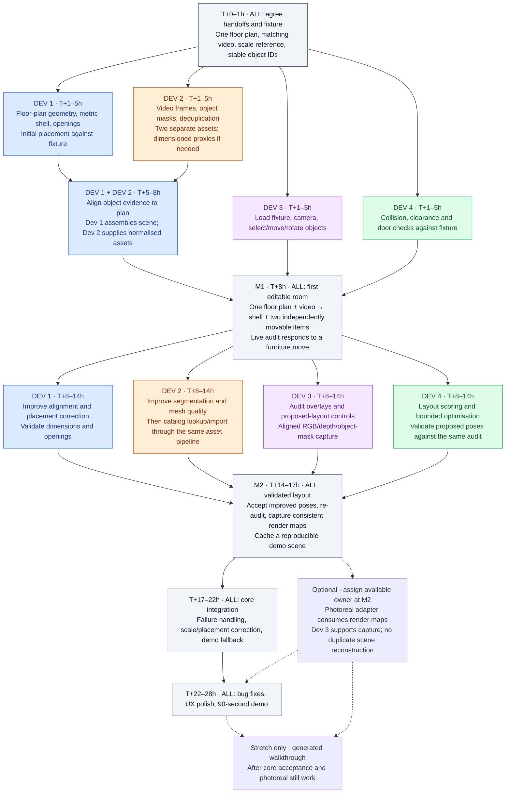

# SpaceShift — System Architecture & 4-Developer Execution DAG

## 1. Ownership and implementation boundaries

Split the difficult reconstruction work between room geometry and individual
furniture assets. Service folders describe runtime boundaries; they do not imply
one developer per service. Keep the existing folders, ports, and shared room models.

| Owner | Responsibility | Deliverable |
| --- | --- | --- |
| Dev 1 — Room geometry and scene assembly | Parse the floor plan, establish metric scale, extrude walls/openings, align video observations with the plan, place furniture | Room shell and assembled `RoomScene` |
| Dev 2 — Furniture and asset pipeline | Select video frames, segment and deduplicate furniture, reconstruct individual meshes, normalise assets; later import retailer assets through the same pipeline | Separately movable furniture meshes, dimensions, stable IDs, and source metadata |
| Dev 3 — Editor and rendering | Scene loading, furniture manipulation, camera/state, UI, audit overlays, aligned RGB/depth/object-mask export | Interactive editor and render-map bundle |
| Dev 4 — Spatial audit and optimisation | Clearance, collisions, door access, layout scoring, proposed rearrangements, editor feedback integration | `AuditReport` and improved furniture poses |

```text
spaceshift/
├── contracts/                     # Shared room models and mock fixture; coordinate edits
├── services/
│   ├── reconstruction/            # Port 8001: Dev 1 owns app/routes and room assembly
│   │   ├── room/                  # Planned: Dev 1 owns floor plan, shell, placement
│   │   └── assets/                # Planned: Dev 2 owns extraction and mesh normalisation
│   ├── spatial_engine/            # Port 8002: Dev 4 owns audit and solver
│   └── media_gen/                 # Port 8003: Dev 2 owns catalog adapter/app;
│                                  # later photoreal integration is assigned at M2
└── frontend/                      # Dev 3 owns editor, UI, and render-map export
```

`room/` and `assets/` are proposed file ownership boundaries, not implemented
modules. Dev 2 supplies asset functions; Dev 1 wires them into reconstruction
routes. Catalog adapters reuse that asset pipeline rather than implementing a
second mesh generator or normaliser. Dev 2 coordinates any required Python extra
changes with the root manifest owner before importing reconstruction dependencies
from `media_gen`.

Coordinate edits to service entry points, root manifests/lockfiles, and contracts
before implementation. Existing coordinate invariants in `CLAUDE.md` apply:
metres, Y-up, mesh bottom-centre at the origin, logical front facing +Z.
This split reduces overlapping edits; folder ownership cannot guarantee zero conflicts.

## 2. Handoffs to agree at kickoff

These are interface requirements to settle using the existing models where
possible. They do not introduce new API routes or schema fields by themselves.

| Handoff | Producer → consumer | Required agreement |
| --- | --- | --- |
| Room geometry | Dev 1 → Devs 3 and 4 | Metric shell, walls/openings, optional compass, coordinate frame and known scale reference |
| Furniture assets | Dev 2 → Dev 1 → Dev 3 | Stable object ID, mesh location, metric bounds, orientation, source-frame identity and dimension provenance |
| Placement evidence | Dev 2 → Dev 1 | Object IDs tied to source frames/masks; Dev 1 owns alignment and final room poses |
| Assembled scene | Dev 1 → Devs 3 and 4 | Existing `RoomScene`, asset references and initial furniture poses |
| Audit and proposed layout | Dev 4 → Dev 3 | Existing `AuditReport`, proposed poses tied to the same object IDs; preserve shell and asset identity |
| Render maps | Dev 3 → later photoreal adapter | RGB, depth and object masks from one scene revision, camera and resolution; depth encoding/range and mask-ID mapping |

Dev 2 normalises furniture meshes once, regardless of video or catalog source.
Dev 3 applies the resulting scene transforms and exports all render maps from the
same renderer. Dev 4 computes spatial findings; Dev 3 visualises them.

Unknown scale or uncertain placement needs explicit user correction, not an
invented exact measurement. Use dimensioned proxy boxes when mesh extraction
fails, and label them as proxies. Missing compass follows the existing contract
fallback and must remain distinguishable from grounded orientation.

## 3. Execution DAG

Times are target checkpoints, not estimates that guarantee reconstruction quality.
Each owner starts against the shared fixture so development can proceed in parallel.



## 4. Acceptance and scope priorities

**M1:** A matching floor plan and video produce a metric room shell and at least two
separate furniture items. Each item can be moved independently; moving one updates
the spatial audit. Proxy geometry is acceptable if visibly identified. The fixture
unblocks development but does not replace this real-input integration check.

**M2:** The editor can apply a proposed layout and re-run the audit. Mesh bounds,
poses and spatial checks agree in metres. RGB, depth and object masks describe the
same scene/camera. Provider failure still permits editing and auditing the cached
scene. A layout with unresolved violations must be reported as such.

Prioritise room/furniture separation, metric placement, editing and basic spatial
checks. Improve mesh quality next; add catalog imports once video assets work.
Glare/Feng Shui checks and specialised shaders follow the basic audit. Photoreal
stills are optional after M2, with a named owner assigned then. Generated video is
stretch scope and does not gate the working demo.

## 5. Developer focus and ordered task lists

Each issue tracks one workstream. Complete tasks in the order shown; use fixtures
while waiting for a producer's real output. GitHub assignees are unset until the
team maps developer numbers to usernames.

### Dev 1: Room geometry and scene assembly

Tracking issue: [#1](https://github.com/KOLESNiii/AI_HACKATHON_PROJECT/issues/1)

**Focus:** Turn the floor plan into a metric room and align furniture evidence from the video into one editable scene. Own where objects belong.

1. Agree the matching floor plan/video, known scale reference, coordinate frame, object IDs, and handoff shapes with Dev 2; provide a fixture scene to Devs 3 and 4.
2. Parse floor-plan walls, doors, windows and optional compass. Establish scale from a known measurement and flag missing/uncertain measurements for correction.
3. Generate the room shell with openings and metric dimensions; validate against the plan.
4. Consume Dev 2's object IDs, masks/source-frame evidence, bounds and normalised meshes. Align observations to the floor plan and determine initial furniture poses.
5. Assemble the existing RoomScene with shell, asset references and independently placed furniture. Wire the asset functions into reconstruction routes.
6. Integrate M1 with Devs 2–4: one real floor plan/video, two independently movable objects, and live audit feedback. Use labelled proxies if extraction fails.
7. Improve alignment and add scale/placement correction. Validate bounds, openings and poses with Devs 3 and 4 for M2.
8. Cache the assembled demo scene and verify editing/auditing still works when providers fail; document setup and test geometry/assembly behaviour.

### Dev 2: Furniture extraction and reusable asset pipeline

Tracking issue: [#2](https://github.com/KOLESNiii/AI_HACKATHON_PROJECT/issues/2)

**Focus:** Separate the video's furniture into individual, dimensioned, movable assets. Reuse that pipeline for online/catalog assets after real-video extraction works.

1. Agree stable object IDs, source-frame/mask evidence, mesh references, dimension provenance and asset function interfaces with Dev 1. Prepare two fixture assets.
2. Select usable video keyframes, identify furniture and deduplicate repeated views of the same object.
3. Segment/crop each item and retain its ID and source-frame/mask evidence for Dev 1's room alignment.
4. Reconstruct individual furniture meshes through the selected provider. Handle failures explicitly and supply labelled, dimensioned proxy boxes when needed.
5. Implement one mesh normalisation path: metric bounds, bottom-centre origin, front +Z. Keep measured dimensions distinct from estimates and request correction when unknown.
6. Deliver two assets to Dev 1 and integrate M1 with the editor: separate selection/movement, matching IDs and correct bounds. Add checks for normalisation and failure fallback.
7. Improve extraction/mesh quality, then implement retailer URL/search import: source URL, imagery, dimensions and provenance. Reuse the same reconstruction/normalisation functions; do not build a second generator.
8. Validate catalog and video assets with Devs 1, 3 and 4 for M2; cache demo assets, document provider configuration and coordinate dependency-extra changes.

### Dev 3: Interactive editor and aligned render maps

Tracking issue: [#3](https://github.com/KOLESNiii/AI_HACKATHON_PROJECT/issues/3)

**Focus:** Make the assembled room editable and produce consistent RGB, depth and object masks from the same renderer. Own visualisation and interaction.

1. Agree RoomScene loading, stable selection IDs and the audit/proposed-layout handoff with Devs 1 and 4. Start with the shared fixture and mock responses.
2. Build the R3F scene loader, camera and basic UI. Apply the agreed metric transforms and load shell/furniture assets without changing their normalisation.
3. Implement independent selection, move and rotate controls with scene state updates; show loading, missing-asset and proxy states.
4. Connect furniture changes to Dev 4's audit and show collisions, clearance and door-access findings. Prevent stale audit responses from overwriting newer scene feedback.
5. Integrate M1 with Devs 1, 2 and 4 using the real-input scene: two separately movable items and audit feedback after a move.
6. Add proposed-layout preview/apply controls and re-audit the accepted poses. Keep furniture IDs and mesh references stable.
7. Export aligned RGB, depth and object masks from one scene revision, camera and resolution. Document depth encoding/range and the mask-ID mapping for the later photoreal adapter.
8. Verify M2 with Dev 4, cache/load the demo scene, and polish correction/error flows. Add meaningful interaction/capture checks; prioritise basic audit overlays before specialised shaders.

### Dev 4: Spatial audit and layout optimisation

Tracking issue: [#4](https://github.com/KOLESNiii/AI_HACKATHON_PROJECT/issues/4)

**Focus:** Evaluate whether the current room layout is usable and propose better furniture poses. Own spatial truth, scoring and optimisation.

1. Agree the existing RoomScene/AuditReport handoff and proposed-pose representation with Devs 1 and 3. Build deterministic fixture cases including known collisions and clear layouts.
2. Implement metric furniture collision, room-boundary and door-swing/access checks using the same object bounds/poses as the editor.
3. Implement clearance/walkable-area checks and return actionable findings tied to stable object IDs. Validate untrusted scene input and handle degenerate geometry explicitly.
4. Connect the audit to Dev 3's furniture edits. Integrate M1: moving an item in the real-input scene updates the report.
5. Define transparent layout scoring and bounded optimisation with fixed shell/openings and stable asset identity. Start with a simple candidate search before adding solver complexity.
6. Return proposed furniture poses, re-run the same audit on candidates, and report remaining violations or failure to find improvement honestly.
7. Integrate preview/apply/re-audit with Dev 3 and validate metric consistency with Devs 1 and 2 for M2; test that scene geometry and IDs are preserved.
8. Profile the core checks, cover boundary/failure cases and cache demo results. Add glare/Feng Shui checks only after the basic audit/solver works; honour the existing missing-compass fallback.
