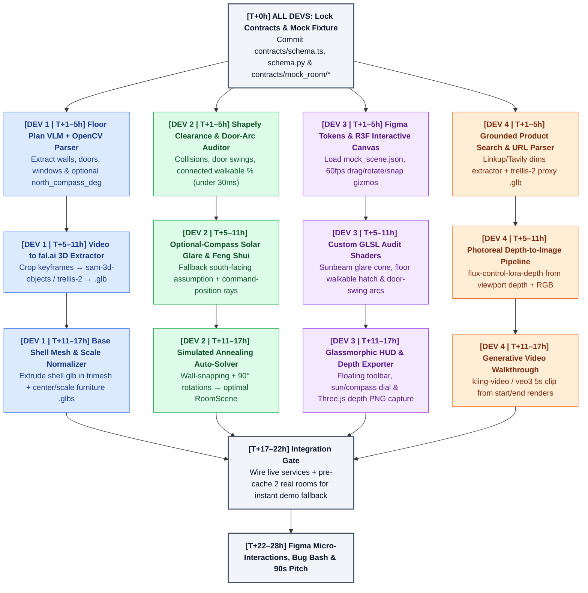

# SpaceShift — System Architecture & 4-Developer Execution DAG

## 1. Monorepo Isolation Rules
To allow 4 developers and their AI coding agents (Claude Code / Cursor) to work simultaneously with **zero merge conflicts**, each developer owns one top-level folder. `contracts/` is locked at **T+0h**.

```text
spaceshift/
├── CLAUDE.md                   # Global agent rules & coordinate system invariants
├── contracts/                  # [LOCKED AT T+0h] Shared schemas + Mock Room Fixture
│   ├── schema.py               # Pydantic v2 models
│   ├── schema.ts               # Exact TypeScript mirror
│   └── mock_room/              # mock_scene.json + shell.glb + bed.glb + desk.glb + wardrobe.glb
├── services/
│   ├── reconstruction/         # [DEV 1] Floor plan parser + video -> fal.ai .glb extractor (Port 8001)
│   ├── spatial_engine/         # [DEV 2] Audit metrics + simulated annealing solver (Port 8002)
│   └── media_gen/              # [DEV 4] fal.ai Photoreal/Video + Linkup/Tavily search (Port 8003)
└── frontend/                   # [DEV 3] Figma HUD + R3F 3D viewport + GLSL shaders (Port 5173)
```

