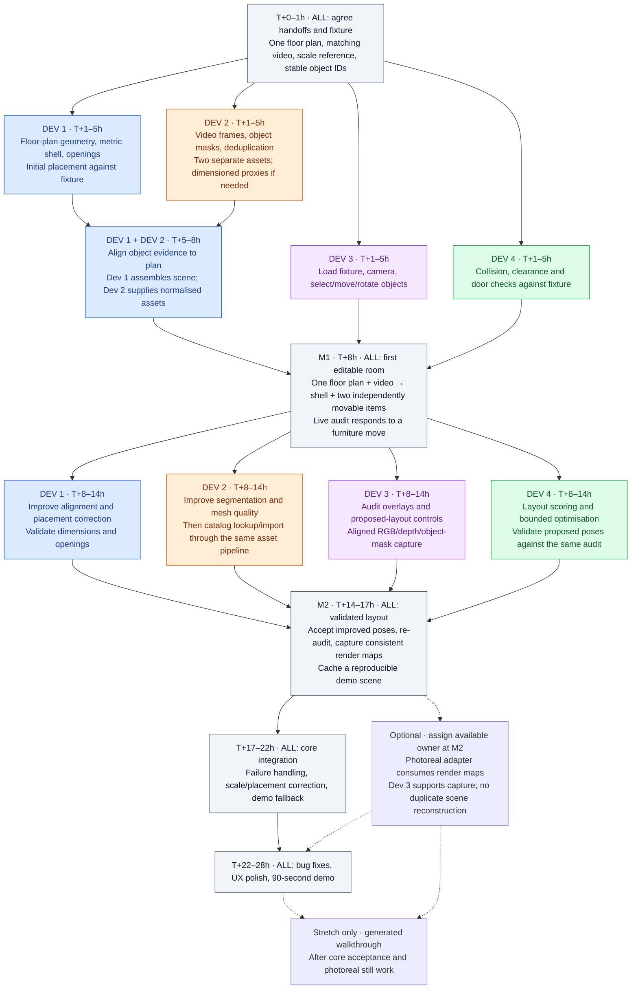

# SpaceShift — System Architecture & 4-Developer Execution DAG

## 1. Ownership and implementation boundaries

Split the difficult reconstruction work between room geometry and individual
furniture assets. Service folders describe runtime boundaries; they do not imply
one developer per service. Keep the existing folders, ports, and shared room models.

| Owner | Responsibility | Deliverable |
| --- | --- | --- |
| Dev 1 — Room geometry and scene assembly | Parse the floor plan, establish metric scale, extrude walls/openings, align video observations with the plan, place furniture | Room shell and assembled `RoomScene` |
| Dev 2 — Furniture and asset pipeline | Select video frames, segment and deduplicate furniture, reconstruct individual meshes, normalise assets; later import retailer assets through the same pipeline | Separately movable furniture meshes, dimensions, stable IDs, and source metadata |
| Dev 3 — Editor and rendering | Scene loading, furniture manipulation, camera/state, UI, audit overlays, aligned RGB/depth/object-mask export | Interactive editor and render-map bundle |
| Dev 4 — Spatial audit and optimisation | Clearance, collisions, door access, layout scoring, proposed rearrangements, editor feedback integration | `AuditReport` and improved furniture poses |

```text
spaceshift/
├── contracts/                     # Shared room models and mock fixture; coordinate edits
├── services/
│   ├── reconstruction/            # Port 8001: Dev 1 owns app/routes and room assembly
│   │   ├── room/                  # Planned: Dev 1 owns floor plan, shell, placement
│   │   └── assets/                # Planned: Dev 2 owns extraction and mesh normalisation
│   ├── spatial_engine/            # Port 8002: Dev 4 owns audit and solver
│   └── media_gen/                 # Port 8003: Dev 2 owns catalog adapter/app;
│                                  # later photoreal integration is assigned at M2
└── frontend/                      # Dev 3 owns editor, UI, and render-map export
```

`room/` and `assets/` are proposed file ownership boundaries, not implemented
modules. Dev 2 supplies asset functions; Dev 1 wires them into reconstruction
routes. Catalog adapters reuse that asset pipeline rather than implementing a
second mesh generator or normaliser. Dev 2 coordinates any required Python extra
changes with the root manifest owner before importing reconstruction dependencies
from `media_gen`.

Coordinate edits to service entry points, root manifests/lockfiles, and contracts
before implementation. Existing coordinate invariants in `CLAUDE.md` apply:
metres, Y-up, mesh bottom-centre at the origin, logical front facing +Z.
This split reduces overlapping edits; folder ownership cannot guarantee zero conflicts.

## 2. Handoffs to agree at kickoff

These are interface requirements to settle using the existing models where
possible. They do not introduce new API routes or schema fields by themselves.

| Handoff | Producer → consumer | Required agreement |
| --- | --- | --- |
| Room geometry | Dev 1 → Devs 3 and 4 | Metric shell, walls/openings, optional compass, coordinate frame and known scale reference |
| Furniture assets | Dev 2 → Dev 1 → Dev 3 | Stable object ID, mesh location, metric bounds, orientation, source-frame identity and dimension provenance |
| Placement evidence | Dev 2 → Dev 1 | Object IDs tied to source frames/masks; Dev 1 owns alignment and final room poses |
| Assembled scene | Dev 1 → Devs 3 and 4 | Existing `RoomScene`, asset references and initial furniture poses |
| Audit and proposed layout | Dev 4 → Dev 3 | Existing `AuditReport`, proposed poses tied to the same object IDs; preserve shell and asset identity |
| Render maps | Dev 3 → later photoreal adapter | RGB, depth and object masks from one scene revision, camera and resolution; depth encoding/range and mask-ID mapping |

Dev 2 normalises furniture meshes once, regardless of video or catalog source.
Dev 3 applies the resulting scene transforms and exports all render maps from the
same renderer. Dev 4 computes spatial findings; Dev 3 visualises them.

Unknown scale or uncertain placement needs explicit user correction, not an
invented exact measurement. Use dimensioned proxy boxes when mesh extraction
fails, and label them as proxies. Missing compass follows the existing contract
fallback and must remain distinguishable from grounded orientation.

## 3. Execution DAG

Times are target checkpoints, not estimates that guarantee reconstruction quality.
Each owner starts against the shared fixture so development can proceed in parallel.



## 4. Acceptance and scope priorities

**M1:** A matching floor plan and video produce a metric room shell and at least two
separate furniture items. Each item can be moved independently; moving one updates
the spatial audit. Proxy geometry is acceptable if visibly identified. The fixture
unblocks development but does not replace this real-input integration check.

**M2:** The editor can apply a proposed layout and re-run the audit. Mesh bounds,
poses and spatial checks agree in metres. RGB, depth and object masks describe the
same scene/camera. Provider failure still permits editing and auditing the cached
scene. A layout with unresolved violations must be reported as such.

Prioritise room/furniture separation, metric placement, editing and basic spatial
checks. Improve mesh quality next; add catalog imports once video assets work.
Glare/Feng Shui checks and specialised shaders follow the basic audit. Photoreal
stills are optional after M2, with a named owner assigned then. Generated video is
stretch scope and does not gate the working demo.
