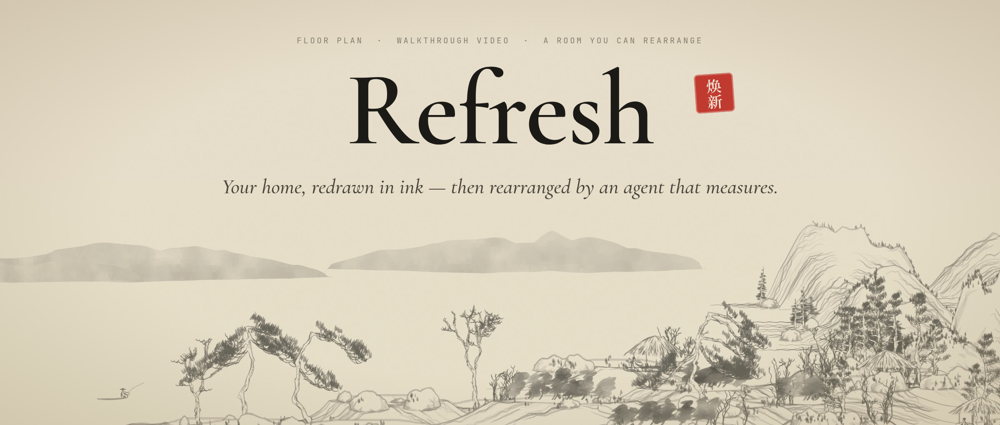
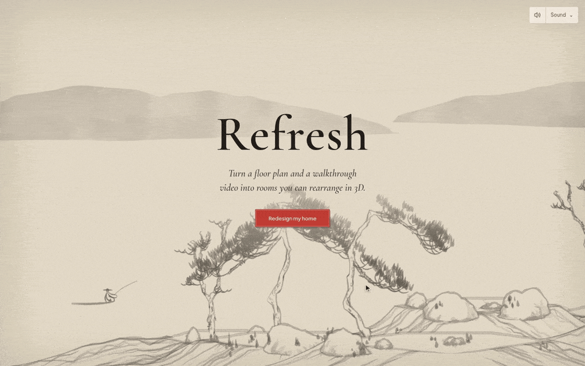
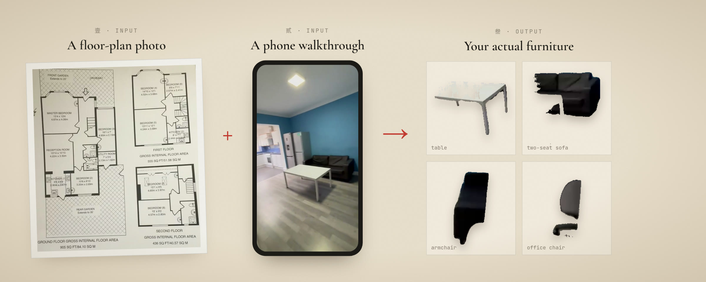
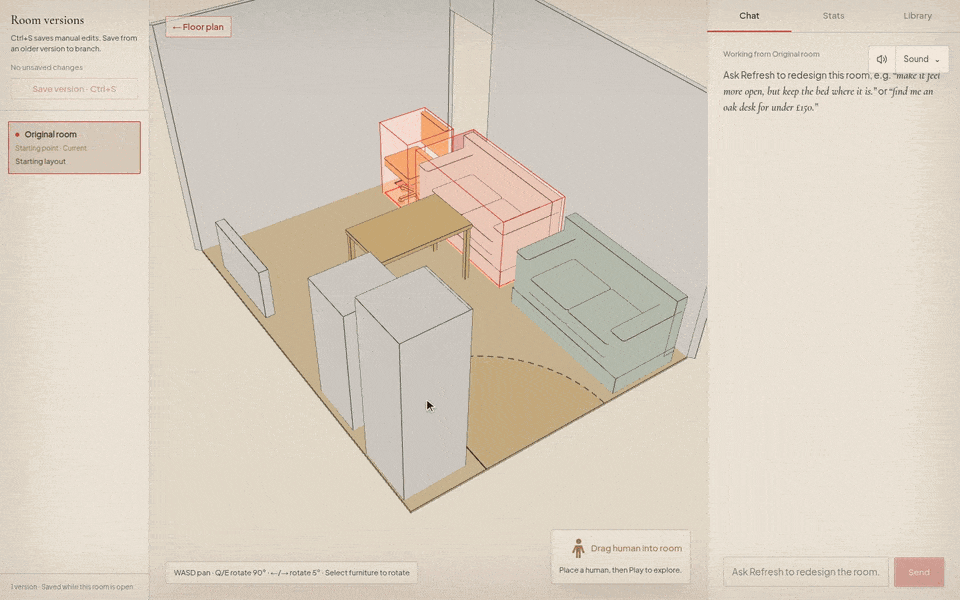
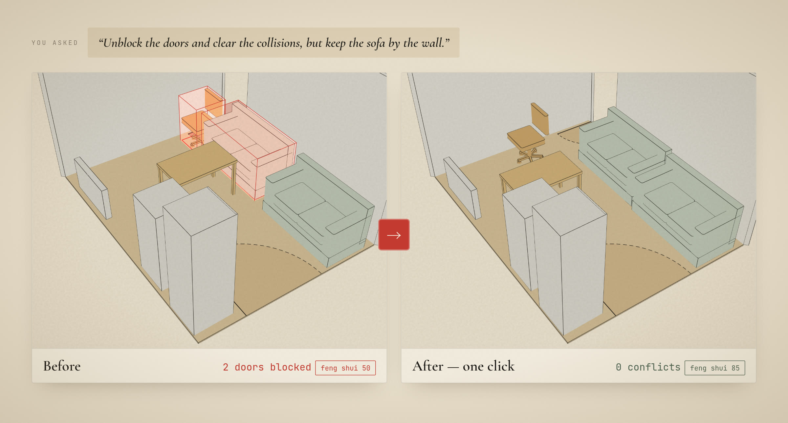
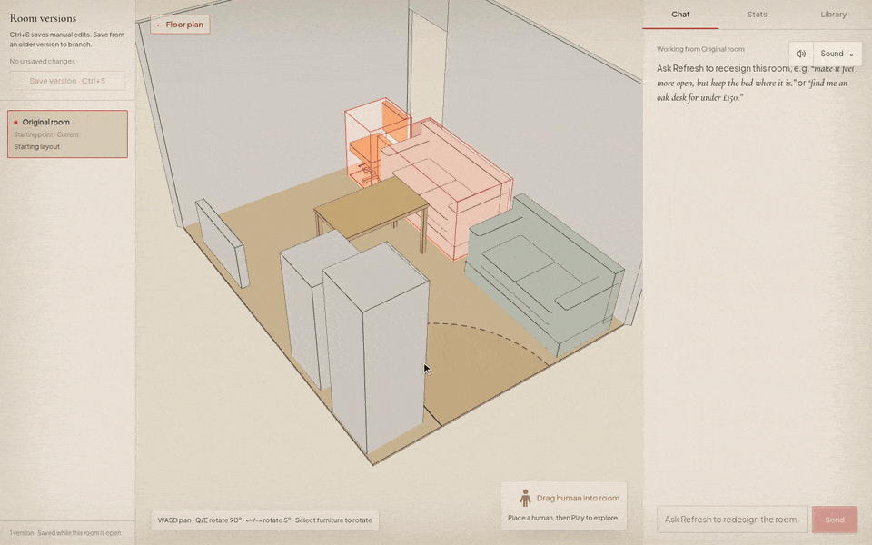
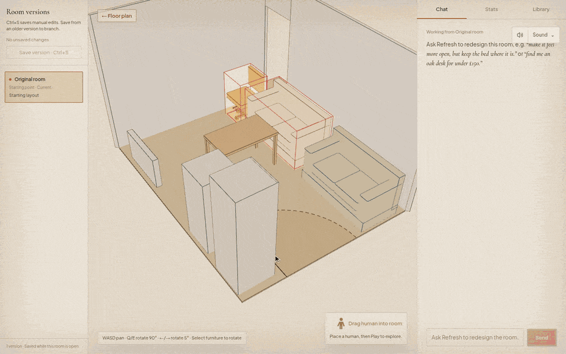

<p align="center">
  
</p>

<p align="center">
  <em>Photograph a floor plan. Film a walkthrough on your phone.<br>
  Refresh turns them into a room you can rearrange in 3D, ask an agent to fix, and walk through yourself.</em>
</p>

<p align="center">
  <a href="#-see-it-in-motion">See it in motion</a> ·
  <a href="#-try-it-locally">Try it</a> ·
  <a href="#-under-the-hood">Under the hood</a> ·
  <a href="docs/DEVELOPMENT.md">Developer guide</a>
</p>

<br>

<p align="center">
  
</p>

---

## 壹 &nbsp;Start with what you already have

Most room planners hand you a blank grid and a catalogue of generic boxes. Refresh starts from
**your** home instead: a photo of the estate-agent floor plan and a shaky phone video of the room.

The plan becomes walls, doors and windows measured in real metres. The video becomes **your actual
furniture**: the table, the sofa and the office chair, each cut out and rebuilt as its own movable 3D
object.

<p align="center">
  
</p>

## 贰 &nbsp;Pick a room, and it builds itself

Click any room on the plan and Refresh builds it: walls go up, door swings are drawn in, and the
furniture is placed where it really stands.

<p align="center">
  
</p>

## 叁 &nbsp;Move anything, and the room answers back

Drag a chair and you see the result straight away. Pieces that collide turn red, a blocked door
swing lights up, and the **Stats** panel updates as you go: how much floor you can still walk on,
which doors are blocked, how much space is left in front of each piece, and a Feng Shui score that
explains how it got its number.

<p align="center">
  
</p>

## 肆 &nbsp;Or just ask

Describe what you want in plain English. The agent proposes a new layout, checks every move for
collisions, blocked doors and clearance, and shows you a before-and-after with the measurements.
Nothing changes until you press **Accept**.

<p align="center">
  
</p>

<p align="center">
  
</p>

> *“Unblock the doors and clear the collisions, but keep the sofa by the wall.”*
> Two blocked doors become zero, and the Feng Shui score goes from **50 → 85**, in one request.

## 伍 &nbsp;Shop with real dimensions

The **Library** holds 100 real IKEA products, each with its published size, price and 3D model.
Spin one around and drop it in, and it comes with its true footprint, so a sofa that *looks* like it
fits has to actually fit. You can also paste a product link from another retailer to import it.

<p align="center">
  
</p>

## 陆 &nbsp;Then step inside

Drop a little figure onto the floor, press **Play**, and walk the room at eye height with the
mouse and WASD. The sun moves across the windows and furniture casts real shadows. Press **L** to
drag the time of day towards dusk and turn the lamps up.

<p align="center">
  
</p>

---

<p align="center">
  
  <br>
  <sub><em>顺其自然: let things follow their natural course.</em> Even the loading screens are ink landscapes, with music to match.</sub>
</p>

---

## ✦ &nbsp;See it in motion

| | |
|:--|:--|
| **Read the plan** | A photographed floor plan becomes rooms with real-metre walls, doors and windows |
| **Lift the furniture** | Your walkthrough video becomes separate, correctly sized 3D models of what you own |
| **Check every move** | Collisions, door swings, walking space and front clearance, updated as you drag |
| **Ask the agent** | Plain-English requests become measured proposals you can accept or reject |
| **Keep every version** | Save layouts, go back, branch off and compare |
| **Shop to size** | 100 real IKEA pieces, or paste a link to import from another retailer |
| **Walk it** | First-person mode with moving sunlight, shadows and adjustable lamps |

## ⚙ &nbsp;Under the hood

<table>
<tr>
<td width="33%" valign="top">

**The room**<br>
React 19 · Three.js · React Three Fiber, with a hand-drawn ink style for editing and realistic
lighting for walking through.

</td>
<td width="33%" valign="top">

**The eyes**<br>
<a href="https://fal.ai">fal.ai</a>: SAM 3 cuts out each piece of furniture and TRELLIS.2 rebuilds
it in 3D. Every model is then rescaled to true metric size.

</td>
<td width="33%" valign="top">

**The brain**<br>
Claude runs the layout agent through tool calls. A geometry engine (FastAPI · Shapely · NumPy)
checks every move before you see it.

</td>
</tr>
</table>

Three small Python services (reconstruction, spatial engine, media) sit behind a Vite frontend.
The architecture, API contracts and design decisions are in [`docs/`](docs/), and the full
developer guide is in [**docs/DEVELOPMENT.md**](docs/DEVELOPMENT.md).

## ▶ &nbsp;Try it locally

You'll need [Bun](https://bun.sh) and [uv](https://docs.astral.sh/uv/).

```bash
bun run setup && cp .env.example .env

bun run dev:reconstruction   # terminal 1
bun run dev:spatial          # terminal 2 (needed for the chat agent)
bun run dev                  # terminal 3 → http://localhost:5173
```

Choose **Redesign my home → Skip with demo home** to explore without any API keys.
Add `ANTHROPIC_API_KEY` to `.env` to talk to the agent, and `FAL_KEY` to reconstruct your own
furniture from video.

## ♡ &nbsp;Made by

**Timofey Kolesnichenko · Leo Matteucci · Anita Kercso-Molnar · Dorian Turner**

<sub>
Ink landscapes generated with <a href="https://github.com/LingDong-/shan-shui-inf">shan-shui-inf</a> by Lingdong Huang (MIT).
Soundtrack: “Reverie” by Scott Buckley (CC BY 4.0), see the <a href="frontend/public/audio/NOTICE.md">audio notice</a>.
IKEA names, images and models belong to IKEA, and this project is not affiliated with IKEA (see the <a href="frontend/public/catalog/ikea/NOTICE.md">library notice</a>).
</sub>
