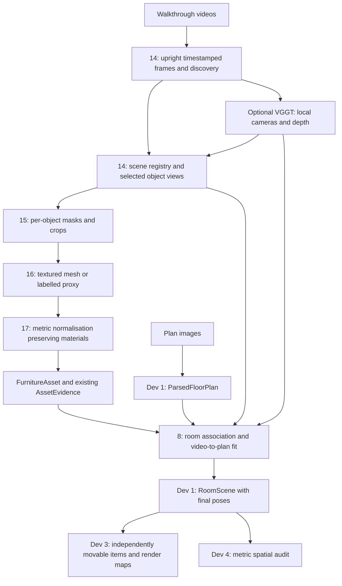

# Video frame selection and furniture identity — issue #14

Status: design and empirical findings; the #14 vertical slice is implemented.
See the implementation plan execution record for delivered scope and deferred options.
Branch: `feat/dev2-select-video-frames-and-deduplicate-furniture`.
Baseline inspected: `817bda7` (also the local `origin/main` at inspection).

## Goal and scope

Select useful observations of the existing furniture and assign one persistent ID per
physical object. Preserve the source pixels and coordinate information needed to reconstruct
its appearance and recover where it stood. Consider the complete pipeline without making
#14 implement segmentation (#15), meshing (#16), normalisation (#17), alignment (#8), or
editor integration (#18).

Deliver #14 as a frame-selection/discovery module, a persisted scene registry, an inspectable
selection report, and offline tests. It returns internal selection records, not pretend
finished `FurnitureAsset`s. `extract_furniture(video_path: Path, scene_id: str)` remains the
agreed eventual façade across #14–#16.

The locked contracts, existing `assets/models.py`, function signature, and `room/` ownership
remain unchanged. Additional evidence is stored in an internal sidecar; any new Dev 1
accessor must be agreed before integration. This document does not approve a handoff change.

## Evidence from the supplied examples

Local inspection on 2026-11-14:

| Video | Video-stream duration | Source frames |
| --- | ---: | ---: |
| `examples/three_floor_1.mp4` | 347.10 s | 10,326 |
| `examples/three_floor_2.mp4` | 217.77 s | 6,518 |
| `examples/three_floor_3.mp4` | 228.19 s | 6,836 |
| `examples/three_floor_4.mp4` | 350.77 s | 10,495 |

All are encoded at 848 × 480 with display rotation −90°, displaying as 480 × 848.
Nominal and average frame rates differ; `frame_index / nominal_fps` is not a reliable
timestamp. Use decoded presentation timestamps and retain the original frame ordinal.
The four clips contain about 19 minutes of footage. They visit rooms, corridors, stairs,
bathrooms and outdoors; a clip is not a room or a storey. Sparse contact sheets do not prove
the full furniture inventory or which named room each segment belongs to.

The first eight seconds of clip 3 show two separate brown sofas, a white table, a chair and
other furnishings. This is the first identity test: repeated views of either sofa must
associate with that sofa without combining the two. These observations are manual local
inspection, not model detections or measured dimensions.

The offline plan CLI, using recorded annotations, parsed `three_floor.png` into three floors
and 23 regions. Reception Room / Kitchen (1) is merged; Bedroom (2) has a size discrepancy.
Other opening warnings remain. A plan filename does not establish a video-to-room match.
`one_floor.jpg` is not assumed to correspond to these clips.

### Provider probe — executed after explicit upload approval

On 2026-11-14, submitted one eight-second, 16-frame, upright, silent excerpt from the start
of clip 3 to `fal-ai/sam-3/video-rle` with `prompt="sofa"`, and eight images sampled from that
excerpt to `fal-ai/vggt-1b`. Inputs were resized to 384 × 678. VGGT requested prediction JSON
and depth PNGs, base64 arrays, and no point cloud. SAM used `apply_mask=false` and the default
detection threshold. This feasibility probe made exactly two requests; later implementation
vision tests are described below. Endpoints did not report an
immutable model/checkpoint revision, so these results identify endpoint and request options,
not a reproducibly pinned set of weights. Actual billed charges were not returned.

| Check | Observed result |
| --- | --- |
| VGGT request time | 44.24 s, including queue/poll/result retrieval after upload |
| Camera arrays | Eight finite 3 × 4 extrinsics and eight 3 × 3 intrinsics |
| Rotation validity | Maximum orthogonality error 1.2e-7; determinants within 1e-7 of +1 |
| Predictions | Eight per-frame JSON files; first two downloaded and decoded locally |
| Raw array format | `{data, shape, dtype}` with base64 bytes; float32 depth/confidence, bool mask |
| Model-frame image | 518 × 518; actual image occupies columns 112–405 inclusive |
| Camera/depth cross-view consistency | First frame projected into the second: 37 valid RANSAC-filtered SIFT matches, median error 1.13 px, 90th percentile 1.92 px; all below 5 px |
| Depth PNG encoding | uint16; decoded unclipped values agree with raw depth within one quantisation step (1.70e-5 local units) |
| Depth clipping | Export range 0.0872–1.1984; 4.04% and 11.96% of valid pixels in the first two frames lie outside it |
| Confidence | First two arrays span 1.0–1.71; these are not probabilities |
| SAM request time | 7.17 s, including queue/poll/result retrieval after upload |
| SAM masks | 16 strings, each containing one combined binary mask for that frame |
| SAM metadata | One `index`/`box`/null `score` record per frame; no object IDs; `scores` null |
| SAM RLE | 1-based start/length pairs flattened in row-major order; decoded boxes agree across all 16 frames to floating-point precision |

Visual inspection of corrected mask overlays shows both sofas combined in the first frame
and the office chair included in several later frames. Consequently, this text-only video
call is neither an instance inventory nor reliable sofa-only evidence. #15 must validate
per-instance image masks using object-specific box/point prompts before considering temporal
propagation; another tracking endpoint may be evaluated separately. Connected components
alone are not sufficient because one sofa can be occluded into disconnected regions.

The cross-view check supports using VGGT as optional local geometric evidence. It is not
ground-truth camera evaluation: it uses feature matches from one adjacent image pair, and
neither metric scale, floor alignment, all eight views, cross-clip registration nor surface
material reconstruction was verified. No mesh/material generator was called. Use raw depth
for geometry; the display PNGs lose out-of-range values.

Downloaded predictions also contain the full model-frame image as float32 RGB. The eight
JSON files total 60.1 MB, versus a 183 KiB input video excerpt. Retain the minimum needed
outputs: use documented `exclude_keys` options only after checking that selected fields can
be omitted without losing preprocessing/geometry evidence. Persist the actual integer
resize/padding: the valid image is 294 pixels wide, not an unrounded aspect-ratio estimate.

Probe scripts, request IDs, provider payloads, decoded arrays, corrected overlays and an
`analysis-report.json` remain local in `/tmp/spaceshift-issue14/`; no private imagery or
provider artifact URLs are added to Git. The analysis script's shape, finite-value,
rotation, mask/box and depth-quantisation assertions all passed. Temporary artifacts are
not durable application storage or committed regression fixtures.

## Options and recommendation

| Approach | Advantage | Limitation |
| --- | --- | --- |
| Vision labels and appearance matching only | Fast; no camera dependency | Confuses similar beds/chairs; weak placement evidence |
| Full reconstruction before any discovery | Geometry can disambiguate identity and position | Drift, textureless walls and disconnected clips can block the entire job |
| **Hybrid: local sampling, vision discovery, registry, optional geometry** | Useful evidence even when geometry fails; improves identity when geometry is verified | Requires explicit confidence and unresolved matches |

Recommend the hybrid. Prefer fal.ai for discovery and geometry; reserve direct Anthropic
vision for a bounded second opinion on ambiguous object pairs, not metric measurement or
invented camera poses. No Anthropic dependency is needed for the first slice.

### Library reuse requirement

Per the user's instruction, maximise reuse of established libraries, starting with the
project's declared dependencies and Python's standard library. Custom code should express
domain policy, source-coordinate adapters and orchestration. Before implementing a generic
algorithm or subsystem, identify whether the existing stack already supplies it.

| Responsibility | Reuse |
| --- | --- |
| Decode, rotation, timestamps and thumbnails | Installed FFmpeg/FFprobe; `subprocess.run` argument arrays and JSON output |
| Blur/exposure scores, histograms, features and geometric checks | OpenCV primitives, SIFT/ORB, matchers and RANSAC; NumPy vector operations |
| Typed observations and validation | Existing Pydantic v2; fixed `contracts.schema` and asset models at their current boundaries |
| Provider submissions/status/results and uploads | Existing `fal-client` request handles; reuse SDK retry behaviour rather than implementing another queue client |
| Artifact downloads | Existing HTTPX streaming/timeouts/limits |
| Durable identity and concurrent updates | Standard-library `sqlite3` transactions and constraints; JSON remains a report/export format |
| Pair assignment | Prefer SciPy `optimize.linear_sum_assignment`; coordinate its reconstruction dependency declaration first |
| Mesh load/transforms/bounds/export (#17) | Existing trimesh, subject to material round-trip verification; existing Three.js/Drei for browser loading |
| Offline tests | Existing pytest fixtures, `tmp_path`/`monkeypatch`, and standard-library mocks |

Use SQLite as a local registry file, not a new database service or ORM. Python's
[SQLite interface](https://docs.python.org/3.11/library/sqlite3.html) provides the persistence
mechanism. [SciPy's assignment solver](https://docs.scipy.org/doc/scipy/reference/generated/scipy.optimize.linear_sum_assignment.html)
provides one-to-one cost optimisation, not identity confidence: gating, cannot-link rules
and unmatched alternatives remain domain logic. SciPy is installed and already declared in
the repository, but only in the `spatial` extra. Do not silently make reconstruction depend
on that extra. Agree a small manifest change before adopting it; do not write a custom
Hungarian solver to avoid coordination. If that change is unavailable, explicitly defer
global assignment and retain conservative unambiguous matches.

Do not add a tracking framework, ORM, bespoke feature extractor, geometry engine or generic
retry framework without a demonstrated gap. The successful probe already used existing
OpenCV/NumPy/fal-client/HTTPX. Its tiny NumPy RLE adapter handles the observed start/length
format; it must not be confused with COCO's different RLE representation.

## End-to-end flow and ownership

Scene JSON stays the geometric truth. Cameras, masks, source images and provider payloads
stay out of `RoomScene`; the audit needs no reconstruction metadata. Dev 2 supplies evidence
in the capture's local frame. Dev 1 chooses the room, fits that frame to the plan and calls
`asset.to_item(Pose2D(...))`.

## 1. Source identity and local frame processing

- Fingerprint each source video by bytes; do not use its filename as identity. Preserve
  video-stream index, frame ordinal, PTS and time base. A frame key is scoped by source and
  stream, so equal ordinals in two videos never collide.
- Apply display rotation exactly once. Retain the encoded-to-upright pixel transform and
  original/upright dimensions. Subsequent boxes and masks use upright pixels.
- Use the installed FFmpeg/FFprobe executables for timestamps and decoding, and existing
  OpenCV/NumPy for image scores. Check availability and fail clearly if missing. Do not add
  PyAV, Torch, a database service, or a second package manager for #14.
- Generate cheap thumbnails at approximately 1 Hz, retaining nearby sharp alternatives.
  Keep full-resolution selected images as evidence; do not upscale or relight the only copy.
  Preserve the decode mapping when creating any constant-frame-rate provider excerpt.
- Split at visual discontinuities; flag stairs/outdoors and room transitions as candidate
  boundaries. Labels and floor assignments remain hypotheses until Dev 1 or the user grounds
  them. A temporal cut is not proof of a different room.

## 2. Frame choice has two independent purposes

**Appearance/discovery frames:** prioritise object pixel area, sharpness, exposure,
unclipped boundaries and low occlusion. Global frame sharpness alone is insufficient:
score each detected object's crop. Keep one primary view and up to three useful alternate
views, preferably showing genuinely different sides. Rank colour/material visibility; reject
severe glare, people blocking furniture, and mirror reflections. Do not discard the only
view of an object merely because it falls below an ideal quality threshold; retain it with
a warning. Use a greedy coverage pass so a rare item is not displaced by many good sofa shots.

**Geometry frames:** retain overlapping wide views containing stable walls, floor, windows
and doors. Start with 16–24 frames for a selected continuous room segment and densify gaps
where overlap is poor. Do not send four full walkthroughs into one reconstruction request.
A photogenic close crop can be excellent for texture and useless for camera estimation.

Initial quality thresholds and counts are tuning parameters, not validated accuracy claims.
Bound request count per room job; process remaining candidates in batches, and report
incomplete coverage if the budget is exhausted. Never imply a cap guarantees full coverage.

## 3. Discovery and conservative association

Use `fal-ai/any-llm/vision` with the already-used configurable vision model for structured
observations: category from the fixed enum, concise appearance description, image-local box,
visibility/occlusion, and possible reflection. Validate JSON, finite coordinates, image bounds
and categories. Provider output is untrusted. The existing room annotator is an example of
fal authentication and parsing, not a module to modify or import as an assets dependency.

Associate observations using category compatibility, appearance, temporal continuity and,
when verified, geometry. Appearance alone cannot merge two lookalike objects. A model's
object number and a SAM tracking label are scoped to that request; neither becomes an asset ID.

- Within continuous footage, use one-to-one matching with overlapping observations.
- Two confirmed distinct objects visible together establish a cannot-link relation, unless
  one is a verified reflection. Keep the two clip-3 sofas separate.
- Across a disappearance or a new clip, merge only with adequate corroboration: verified
  common geometry or distinctive appearance plus room context and consistent neighbours.
- Never compare raw positions from different coordinate groups. Depth surface overlap and
  floor-contact evidence are preferable to blindly comparing bounding-box centres, whose
  locations change as different parts become visible.
- Leave ambiguous matches unresolved and show them in the report for confirmation. Prefer
  a visible possible duplicate to silently losing a real object. No identity guarantee is
  claimed until this ambiguity is resolved for the acceptance inventory.

Persist confirmed identity before masks or mesh generation so retries, failed meshing and
proxy upgrades do not change IDs.

## 4. Durable per-scene registry

Use a versioned local SQLite registry beneath a configured runtime data directory outside
tracked sources, accessed through standard-library `sqlite3`. Export JSON for inspection.
Record source fingerprints, frame keys, detector configuration/version, observations,
selected views, object IDs, local track references, coordinate-group references, ambiguity
decisions and stage status. Retain retired IDs and merge aliases; never recycle an ID.
Do not put credentials, private absolute source paths, or expiring provider URLs in a
committed fixture. Frame/mask artifact references resolve through the local store.

IDs follow `ITEM_ID_PATTERN`. Allocate once, rather than deriving identity from detection
order. Repeated input loads cached observations; an explicit re-detect reconciles against
the existing registry. A category correction never renames the object. Missing observations
on a retry do not delete existing items. Manual merges choose a survivor with aliases; splits
retain the original ID for one confirmed object and allocate a new ID for the other.

Use SQLite transactions for allocation and reconciliation, with uniqueness constraints on
scene/object IDs and source-frame keys. Read the current revision inside the write transaction;
rollback on failure and bound lock waiting. Do not build a parallel file-lock/atomic-JSON
transaction mechanism. Keep expensive provider calls outside write transactions and record
their completed results so a crash does not require rebilling every previous stage. Unknown
schema versions and corrupt registry data cause an explicit error, not a silent fresh registry.

## 5. Camera recovery and placement against the room design

The [fal VGGT API](https://fal.ai/models/fal-ai/vggt-1b/api) documents camera-from-world
extrinsics, intrinsics in a padded 518 × 518 image frame, depth and confidence outputs.
Persist input order, preprocessing transforms, camera convention, coordinate-group ID and
model version when available. Treat scale as ungrounded until matched to plan measurements.
The small live probe above verifies the response shape and adjacent-view consistency only;
longer sequences and actual plan placement still need evaluation.

For an upright source pixel, apply the recorded model resize/padding transform before using
the intrinsics. With camera-depth `d`, `Xc = d K^-1 [u,v,1]` and `Xw = R^T(Xc - t)` for
camera-from-world `[R|t]`; camera centre is `-R^T t`. Confirm the depth convention from the
payload before using this formula. Confidence values require calibration, not interpretation
as probabilities. Prefer raw float32 depth to clipped display PNGs, and exclude padding using
the returned mask. Never substitute a mask/box centre for a grounded floor-contact point.
At #15, robust depth samples inside masks can support object surfaces and floor anchors.

Dev 1's #8 must:

1. Associate a segment with a candidate `ParsedRoom` on a specific floor. Repeated room shapes
   on different storeys cannot be resolved by X/Z alone.
2. Estimate gravity/floor and stable wall/opening correspondences; remove furniture, people
   and reflection outliers. Convert the local OpenCV-oriented world to the project's Y-up
   frame explicitly. Video roll is not plan yaw.
3. Fit a positive-scale, proper rotation and translation from local reconstruction into the
   floor's metric frame. Floor/wall planes alone may leave yaw or translation ambiguous;
   doors, windows, labelled correspondences or user anchors must resolve the ambiguity.
4. Check residuals, coverage, competing symmetric fits, camera path plausibility, and furniture
   floor contact. Multiple disconnected reconstructions may require different fits.
5. Apply the accepted fit to both cameras and objects. Infer bottom-centre and front direction
   from evidence separately; preserve the link between generated-mesh axes and observed axes.

Disconnected clips are separate coordinate groups until overlapping static features produce
a verified registration. A multi-image API accepting them together is not proof of a shared
reliable map. Do not assume one rigid fit corrects drift over a whole house.

Unresolved scale, position and front use the existing `correction_needed` reasons
`dimensions`, `placement`, `orientation` at asset/scene assembly. Category priors and generated
mesh size remain `dimension_source="estimated"`. A measured floor plan alone does not make
every furniture dimension measured: it also needs a validated geometric measurement chain.
No manual correction UI is added by #14; its report exposes the evidence for later consumers.

## 6. Preserve materials as well as meshes

Video records appearance under lighting, not original shader programs or exact BRDF values.
The achievable goal is faithful observed colour/texture and plausible PBR appearance. Keep
unmodified primary and alternate views so later stages can improve it without resampling.

The current [SAM 3D endpoint](https://fal.ai/models/fal-ai/sam-3/3d-objects/api) supports frame
plus masks and requires `export_textured_glb=true` for baked textures/UVs. Its poses are
evidence in that provider's own convention, not automatically compatible with VGGT.
[TRELLIS 2](https://fal.ai/models/fal-ai/trellis-2/api) takes one image; request 1024 textures
and a small vertex target, then verify the actual triangle budget.
[Meshy multi-image](https://fal.ai/models/meshy/v7.1/multi-image-to-3d/api) accepts up to four
views and supports `should_texture=true`, `texture_model="meshy-7"`, `enable_pbr=true`.
It is an alternative for #16 evaluation, not a default provider switch in #14. The documented
`meshy-n1` texture mode rejects PBR; do not combine those options.

In #17, preserve UV seams, normals/tangents, material assignments, base colour and all available
normal/roughness/metallic/occlusion maps, factors and colour-space semantics. Bake transforms
with correct normal handling; re-unwrap/rebake if simplification changes UV topology. Avoid
geometry-only concatenation that discards materials. Any trimesh/export path must be tested
on a textured multi-material fixture; do not assume arbitrary glTF extensions round-trip.

The existing profile still applies: embedded textures, standard metallic-roughness, 1024 px
base colour, ≤30,000 triangles, ≤4 primitives, ≤3 MB, metre bounds within 1 mm, Y-up,
bottom-centre origin and front +Z. Optimisation must not silently replace the appearance with
flat grey. Preserve the raw asset for retry if the normalised result fails the material check.
Dev 3 must retain loaded materials when cloning an item; selection/audit highlights must
restore them. Mesh-quality and round-trip tests belong to #16–#18, not #14 completion.

## 7. Fixed handoff compatibility and multiple videos

The existing `EvidenceFrame` has a source frame index and timestamp but no video identity or
typed camera fields; `AssetEvidence.primary_frame_index` is singular. `provider_pose` is
documented as raw SAM 3D metadata. Do not repurpose it as a new VGGT envelope or change
frame indices into synthetic global indices without agreement.

#14's internal selection records use full frame keys and accept a set of sources; the
scene registry can therefore reconcile repeated observations across clips. This does not
change `extract_furniture(Path, scene_id)` into a list-taking function. For its single-video
adapter, existing evidence keeps genuine ordinals/timestamps and the corresponding capture
manifest identifies that source. Complete multi-video evidence and camera arrays stay in the
sidecar, without being forced into the old shape.

Before #8/#9 integration, Dev 1 must agree how room-job orchestration resolves that sidecar
and supplies the 1–5 videos from `RoomCaptureInputs`. An additive internal reader keyed by
`scene_id` and `asset_id` is the recommended option; it is not yet an agreed interface. Until
then, demonstrate #14 on one room segment and report cross-clip results via the selection
artifact. Do not claim full multi-video HTTP support or rename the fixed shared contracts.

`FurnitureAsset.evidence` is currently required, despite older prose describing nullable
catalog evidence. Follow the actual model; resolve catalog behaviour in #19 rather than
changing it for this task.

## 8. Provider boundaries, configuration and failures

| Integration | Input → output | Configuration | Failure behaviour |
| --- | --- | --- | --- |
| fal vision discovery | Upright candidate image → validated observations | `FAL_KEY`; configurable endpoint/model | Bounded retry; preserve frames; mark discovery incomplete |
| Optional fal VGGT | Ordered overlapping images → local cameras/depth | `FAL_KEY`; endpoint and frame cap | Preserve discovery; keep geometry ungrounded |
| SAM 3 tracking/segmentation (#15) | Short excerpt and prompt → request-local tracks/masks | `FAL_KEY`; threshold and excerpt budget | Keep observations/IDs; report unavailable masks |
| Anthropic second opinion (optional later) | Ambiguous crop pair/context → match suggestion | Explicitly map `ANTHROPIC_API_KEY` or legacy `ANTHROPIC_KEY` | Leave pair unresolved; never invent geometry |

Read keys only server-side; do not log them. Do not rename `.env` or commit it. Any new
environment defaults and root manifest changes require coordination before implementation.
Timeouts must cancel queued work when supported; record request IDs so retries can recover
results. Rate/concurrency limits and request caching prevent accidental whole-video spend.
Download provider artifacts before treating them as durable evidence. Validate artifact
size/type and allowed destinations at network boundaries; uploaded file handling remains
Dev 1's route responsibility.

A missing key or zero detections cannot produce a credible inventory: report incomplete
discovery rather than treating an empty list as success. Known registry items survive later
provider failure. Actual labelled proxy construction, estimated dimensions and asset serving
arrive in #16/#17; never emit a fake mesh URL in #14.

## Verification and release gates

Executed during planning: local FFprobe and contact-sheet inspection; offline three-floor
parser CLI; 64 passing tests across contracts, collision-part validation, shared fixture and
floor-plan parsing; asset-module Ruff lint/format and mypy; the two live calls and artifact
assertions described above. These establish a compatible baseline and provider feasibility,
not #14 acceptance.

#14 acceptance requires manually annotated target sightings for a bounded real room segment:
all target items covered, repeated views retain identity, both sofas stay separate, and a
re-run or detector-order shuffle preserves IDs. Add a cross-clip overlap case and a similar
item on a different floor as regression cases. If room identity is unknown, show that status
and do not assert different floors from appearance alone. Tests must run offline from
recorded/synthetic provider responses; live evaluation is opt-in and records model/version,
parameters, runtime and limitations without secrets or raw private media in Git.

Subsequent end-to-end gate (#18): two items become separate textured/material-preserving
normalised assets or visibly labelled proxies, receive grounded or correction-marked poses
from #8, move independently, keep IDs/bounds through mesh swaps, and produce a consistent
audit. Recovery from provider failure must preserve the editable scene. A provider API
returning camera arrays alone does not verify metric placement or material fidelity.

## Decisions needing coordination before integration

1. Dev 1: sidecar access and multi-video room-job orchestration, retaining the fixed façade.
2. Dev 1: room/segment assignment and minimum accepted registration/plan-fit evidence.
3. Dev 3: material-preserving mesh load/highlight behaviour and later correction UI.

The original planning phase made no team messages or Git writes. The subsequent implementation
request authorises a commit, branch push and pull request; it does not authorise a merge.

## Implementation validation and limits

The implemented #14 selector uses FFmpeg/OpenCV, Pydantic, fal-client and transactional SQLite,
without dependency or shared-model changes. See `services/reconstruction/assets/README.md` for
API/CLI usage and `docs/superpowers/plans/2026-11-14-video-frame-selection.md` for scope decisions.

Three further vision requests used eight sampled original frames from the approved excerpt:
Gemini Flash on a contact sheet, Gemini Flash with separate images, and Sonnet 4.5 through fal
with separate images. The contact sheet missed an item; separate-image proposals still merged
sofa identities or split the office chair into parts. Their `complete` flags during early probe
iterations reflected JSON coverage only and are not accuracy evidence. The final implementation
always marks live proposals as requiring review. It uses the documented `image_urls` input,
not the old singular `image_url` example from the room annotator.

A manually reviewed recording covers the four target items within the first six seconds:
rear sofa, right sofa, table and one office chair. It is explicitly human-reviewed annotation,
not claimed raw model output. Six selected original frames provide repeat sightings; replay,
changed object order, provider failure and persisted IDs are exercised by regression tests.
Original images remain local/runtime artifacts; only source hashes and coarse box annotations
are committed. This demonstrates reviewed frame coverage/identity, not autonomous cross-room
re-identification, production masks, metric placement, mesh generation or shader preservation.
